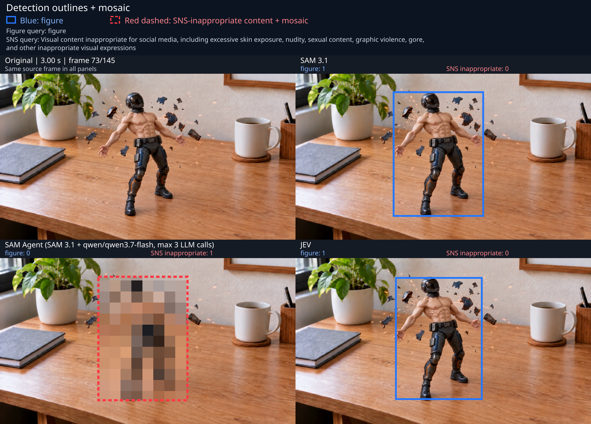
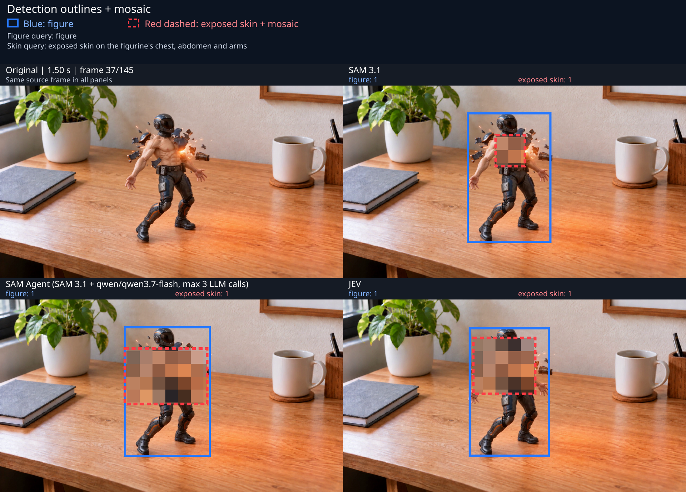
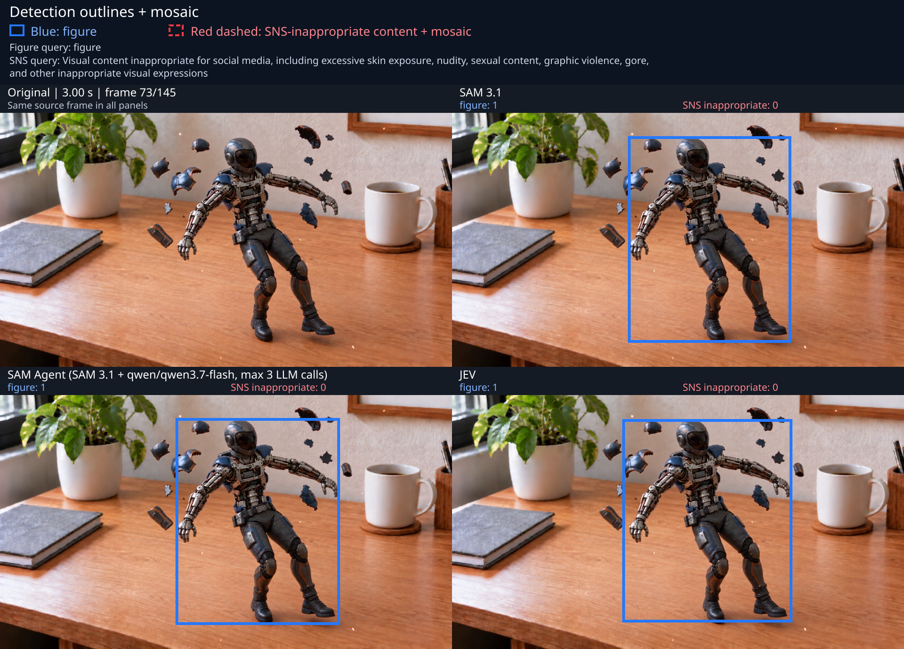

# ブログ掲載用の結果

入力動画2本・3条件の比較から、検出枠とモザイクを重ねた完成動画・GIF・代表画像を選びました。
MP4は1920×1380・24fps・約6.04秒、GIFは高さ320px・20fpsの掲載用軽量版です。
左上が元映像、右上がSAM 3.1、左下がSAM Agent、右下がJevです。
青い実線は `figure`、赤い破線はSNS条件または露出部位です。赤枠の矩形内にモザイクを適用しています。

## 肌動画：SNS条件

[完成動画（MP4）](skin.mp4)／[GIF](skin.gif)

使用設定：[figure](../configs/skin-figure-openrouter-agent.json)／[SNS条件](../configs/skin-sns-openrouter-agent.json)。代表時刻は3.00秒。

## 肌動画：露出部位を明示

[完成動画（MP4）](visible-skin.mp4)／[GIF](visible-skin.gif)

使用設定：[figure](../configs/skin-figure-openrouter-agent.json)／[露出部位](../configs/skin-visible-parts.json)。代表時刻は1.50秒。

## メカ動画：SNS条件

[完成動画（MP4）](mechanical.mp4)／[GIF](mechanical.gif)

使用設定：[figure](../configs/mechanical-figure-openrouter-agent.json)／[SNS条件](../configs/mechanical-sns-openrouter-agent.json)。代表時刻は3.00秒。
SNS条件の検出は全方式で0件のため、赤枠・モザイクはありません。

## 全145フレームの検出数

赤枠が1個以上あるフレーム数です。掲載画像1枚の件数ではありません。

| 条件          | SAM 3.1 | SAM Agent | Jev |
| ------------- | ------: | --------: | --: |
| 肌・SNS条件   |       0 |       109 |  14 |
| 肌・露出部位  |     145 |       116 |  94 |
| メカ・SNS条件 |       0 |         0 |   0 |

肌動画を露出前のframe 0〜25と露出後のframe 26〜144に分けると、次のとおりです。frameは0始まりです。
露出後119フレームをすべて検出対象とした集計で、正解マスクによる位置・範囲の評価ではありません。

| 条件     | 方式      | 露出前の検出 / 26 | 露出後の検出 / 119 | 露出後の未検出 |
| -------- | --------- | ----------------: | -----------------: | -------------: |
| SNS条件  | SAM 3.1   |                 0 |                  0 |            119 |
| SNS条件  | SAM Agent |                 0 |                109 |             10 |
| SNS条件  | Jev       |                 0 |                 14 |            105 |
| 露出部位 | SAM 3.1   |                26 |                119 |              0 |
| 露出部位 | SAM Agent |                 0 |                116 |              3 |
| 露出部位 | Jev       |                 0 |                 94 |             25 |

青枠のfigure検出は肌動画でSAM=145、Agent=108、Jev=144、メカ動画でSAM=145、Agent=140、Jev=145です。
肌のfigure側Agentには判断未完了が9フレームあり、描画時は `INCOMPLETE` と区別しています。赤枠側に未完了はありません。

[manifest.json](manifest.json) に使用設定、入力・画像・動画・GIFのSHA-256、代表フレーム、保存済み集計を記録しました。
入力と結果メディアは元ファイルからコピーし、追加推論は行っていません。
